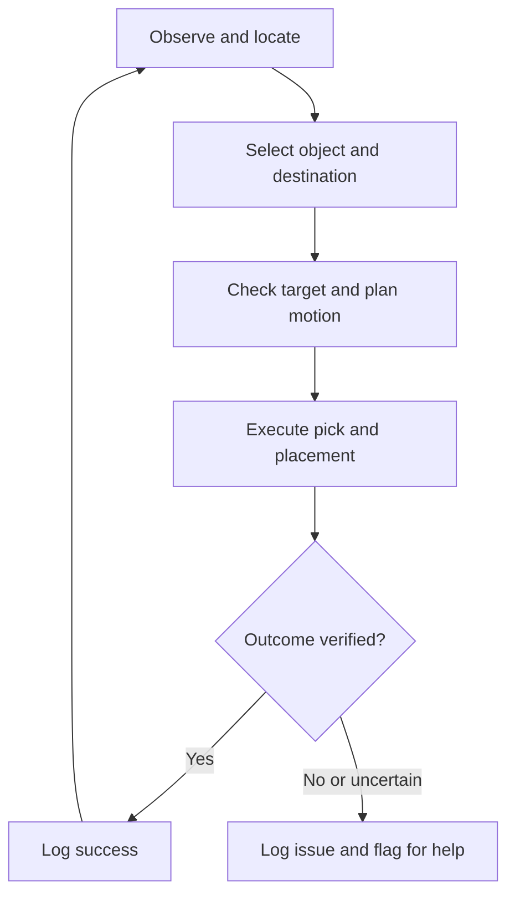

# Architecture — V1

## The Working Loop

Observe the workspace, locate a supported object, choose its destination,
plan and execute the movement, then check what actually happened.

Develop in the supplied digital twin. Validate hardware behavior separately
through the approved physical-arm interface and supervised testing.

## Components

| Piece | Job | Input | Output |
| --- | --- | --- | --- |
| Camera input | Get workspace observations | Simulation or physical cameras | Images, camera identity and calibration |
| Perception | Find supported objects and estimate pose | Images and supported-object assumptions | Category/colour, image position, orientation and uncertainty |
| Coordinate conversion | Convert observations into the robot frame | Measured image pose and calibration | Target position/orientation with explicit units and frame |
| Task selection | Apply sorting rules | Supported objects and destinations | Selected object and destination |
| Robot movement | Approach, grip, lift, carry and release | Validated target and gripper constraints | Commands and execution feedback |
| Outcome checks | Verify actual pickup and placement | New observations and available robot feedback | Success, failure or uncertain |
| Logging | Preserve evidence | Inputs, settings, outcomes and timing | Reproducible trial records |

Do not average coordinates from different camera frames. Calibrate and transform
observations into a common frame before considering multi-view fusion.

## Reuse the Starter

| Starter files | Responsibility |
| --- | --- |
| `scene_config.py`, `cell.py` | Scene layout, geometry, gripper and physics |
| `capture_scene.py` | Calibrated scene capture |
| `perceive.py`, `cube_pose.py` | Cosmos semantics and image-based cube pose measurement |
| `backproject.py`, `plan_sort.py`, `plan_grasps.py` | Coordinate conversion and grasp/task planning |
| `fk.py`, `ik.py`, `sort_scene.py` | Kinematics, grasp execution and simulation reporting |

The supplied perception is hybrid: image geometry measures quantitative cube pose,
and Cosmos handles semantic interpretation/confirmation. It is not independent
VLM-only 6D pose estimation. Cosmos installation and the complete pipeline remain
to be verified in our environment.

The original benchmark requires six cubes stacked yellow, yellow, blue, blue, red,
red. Preserve its gates. Our initial one-cube motion diagnostic and two-colour
sorting milestone are separate tasks and must be labelled accordingly.

## Build Order

1. **Known-position mechanics test:** move one cube using its configured starting
   position. This deliberately bypasses perception only in a separate diagnostic.
2. **Camera-based pick:** derive the target from images; verify pickup and placement.
3. **Two sorting groups:** use two colours of the same supported cube shape with
   defined destinations. Confirm real-cell compatibility first.
4. **Evaluation and physical validation:** test unseen arrangements and the approved
   real task; report simulation and hardware results separately.
5. **Optional adaptation:** assess whether in-context examples improve sorting-rule
   adaptation without weight updates, using a held-out comparison.

## Models and In-Context Learning

Custom training is conditional, not a V1 dependency. Begin with suitable existing
perception components and geometric methods. Add training only to address a
measured limitation with appropriate data and evaluation.

In-context examples may help a pretrained model interpret task rules or supported
object categories. They do not replace calibration, precise pose measurement,
grasp feasibility, or motion checks. Keep the model's output constrained to task
choices; validate those choices before generating robot commands.

An unfamiliar object should be flagged as unsupported or uncertain unless its
recognition and physical handling have been validated. Recognition alone does not
establish that our fingers can grasp it.

## Simulation and Real Hardware

Reuse perception logic, sorting rules, and logging where practical. Camera access
and robot execution need implementations for each environment:

- **Simulation:** supplied Isaac interfaces, with simulator state available for
  evaluation of physical outcomes.
- **Physical cell:** staff-approved image access, command method, coordinate frames,
  and feedback. These details are still open.

The early lab visit should resolve camera availability/calibration, supported
objects, the command interface, and supervised-test access. No physical controller
or PLC changes are assumed permitted.

## V1 Assumptions and Checks

- Fixed tabletop, known workspace boundaries, and separated objects.
- Controlled lighting and supported objects compatible with existing fingers.
- Known dimensions and upright cubes for the initial image-based pose method.
- Defined sorting destinations approved for physical testing.
- Position, orientation, jaw clearance, and reachable approach must all be checked.
- A completed command does not prove pickup; an arm movement does not prove placement.
- Uncertain outcomes are not counted as successes. Automatic recovery comes later.

## Data and Evaluation Rules

- Generate simulation data for development and evaluation; generate training data
  only if training is selected.
- Use supplied real data for inspection and evaluation, not model training, under
  the current project data rule. Confirm permitted use of any newly collected data.
- Separate development examples, in-context demonstrations, and held-out evaluation.
- Ground-truth object poses are for evaluation in the vision pipeline. Do not use
  them to correct detections or secretly provide grasp targets.
- The separate known-position diagnostic is explicitly labelled and excluded from
  camera-based performance results.
- Record scene seed/layout, code/model versions, calibration, settings, every
  attempt, uncertainty/failure, and cycle time.
- Compare methods under equivalent conditions and state all assumptions and limits.

## Verified and Open — October 10

**Verified:** Rosie desktop viewing, scene export, three simulated camera captures,
manual joint movement, and 33 host tests. The one-cube diagnostic passes numerical IK.

**Open:** actual simulated grasp, full model/perception execution, camera-driven
sorting, teammate reproduction, and real-arm integration/performance.
