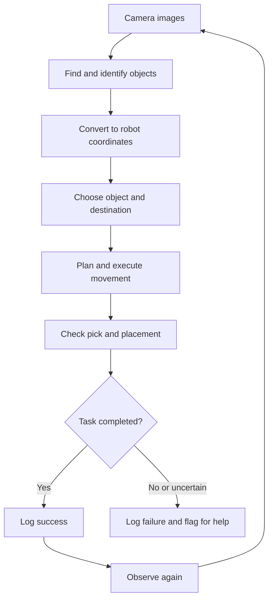

# Architecture — V1

## The Simple Version
See the object → locate it → choose its destination →
pick and place → check the result.

We develop in the digital twin, then validate on the real arm
during supervised testing.

## System Diagram

## The Pieces

| Piece | Plain-English job | Input | Output |
| --- | --- | --- | --- |
| Camera input | Get a picture of the workspace | Simulation or physical camera | Image and camera information |
| Perception | Find supported objects | Image | Object category, image location, orientation if needed |
| Coordinate conversion | Translate pixels into positions the arm understands | Detection and calibration | Object position in robot coordinates |
| Task selection | Choose what to pick and where it belongs | Located objects and sorting rules | Selected object and destination |
| Robot movement | Approach, grip, lift, move, and release | Object position and destination | Execution status |
| Outcome check | Determine whether the object reached its destination | New images and available robot feedback | Success, failure, or uncertain |
| Logging | Keep evidence of every attempt | Inputs, outcomes, and timing | Trial record |

## Important Distinctions
- Knowing an object's category does not tell us where to grasp it.
- A position alone may not be enough; orientation and grip clearance matter.
- A completed robot command does not prove a successful pick.
- Outcome checks need evidence; uncertain results are not counted as successes.
- Simulation success does not guarantee physical success.

## Simulation and Physical Hardware
We aim to reuse perception, sorting rules, and logging across both.

Camera access and robot commands may need separate implementations:
- Simulation: supplied twin and its supported interfaces.
- Physical: interface approved by the plant manager and assigned mentor.

We will inspect the starter project before defining exact functions,
message formats, units, or dependencies.

## V1 Assumptions
- A fixed tabletop and known workspace boundaries.
- Supported objects that the existing fingers can grasp.
- Separated objects under controlled lighting.
- Defined sorting destinations.
- Start with one object category, then add a second.
- Record and flag failed attempts; automatic recovery comes later.

These assumptions must be confirmed using the twin and physical setup.

## Decisions Still Open
- Which objects and sorting rule will we use?
- What starter motion code is supplied?
- What perception method is sufficient?
- Which camera views are needed or required?
- What calibration is supplied?
- How do we estimate grasp position and orientation?
- What interface controls the physical arm?
- What feedback can verify a successful pick and placement?
- Can the twin run on Rosie?

## Data Rules
- Generate training data using the digital twin.
- Use provided real data for inspection and evaluation, not training.
- Keep evaluation trials separate from development trials.
- Log scene settings, code/model versions, and trial outcomes.

## Physical Testing
Physical commands, controller changes, and replacement fingers
require the plant manager and assigned mentor's involvement,
as specified by the competition instructions.