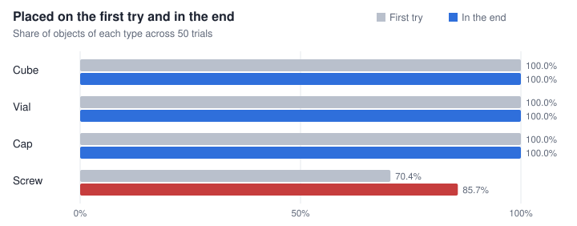
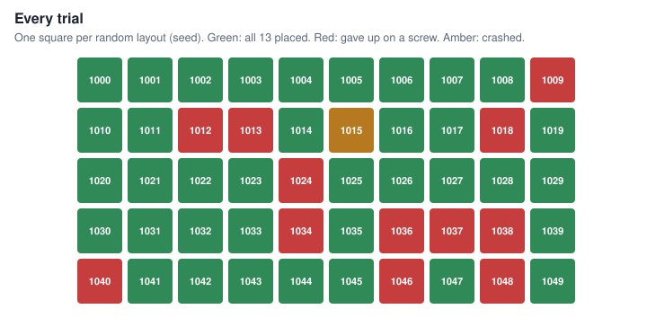
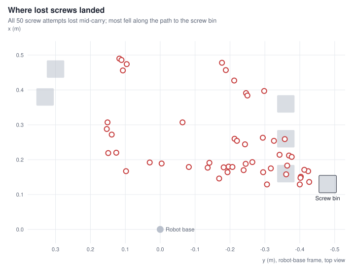
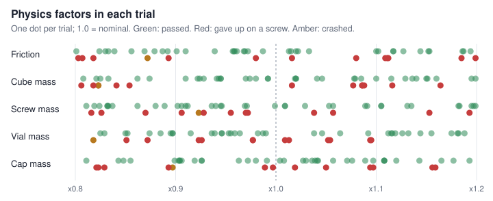
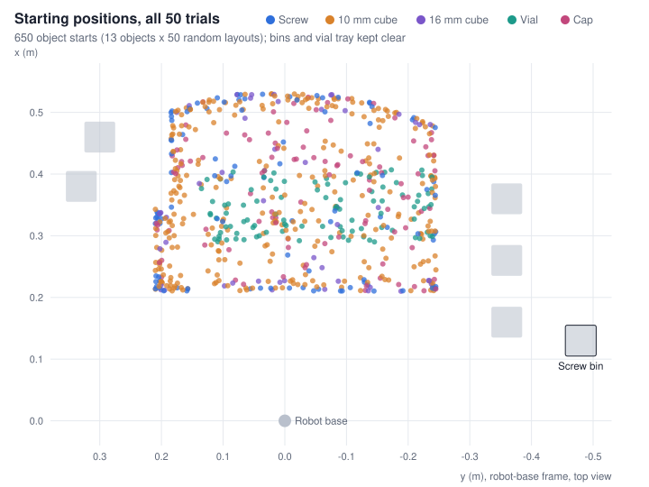

# FANUC ER-4iA sort benchmark: 50 randomized trials

Every cube, vial and cap was placed on the first try (539 of 539). Each of the 12 failed trials gave up on an M6 screw that slipped out of the gripper during the carry; 1 more trial crashed before sorting.

| Result | Value |
|---|---|
| Full sorts completed | **37 of 50** (74%; 95% confidence interval 60% to 84%) |
| Objects placed | **623 of 637** (97.8%), after 81 automatic recoveries in 25 trials |
| Camera checks matching the simulator | **672 of 673**. The robot judged each pick from the overhead camera alone; the simulator's ground truth was used only to grade it |
| Time per full sort | **12.9 min** (29 s per pick attempt; 13.7 min per trial including Isaac Sim start-up) |

## Results by object type

| Object | Objects | Placed first try | Placed in the end | Pick attempts |
|---|---:|---:|---:|---:|
| Cube | 343 | 343 (100.0%) | 343 (100.0%) | 343 |
| Vial | 98 | 98 (100.0%) | 98 (100.0%) | 98 |
| Cap | 98 | 98 (100.0%) | 98 (100.0%) | 98 |
| Screw | 98 | 69 (70.4%) | 84 (85.7%) | 134 |

"In the end" counts objects placed after a camera-triggered rescan and retry (up to three per object).

## Why screws failed

The simulator's record of each screw attempt shows one failure mode. The gripper lifted the screw cleanly, then the round 6 mm shank turned between the flat finger pads during the carry and fell out.

| Screw attempts | Count |
|---|---:|
| Placed | 84 |
| Lost in carry | 50 |
| Not lifted | 0 |
| Bounced out of bin | 0 |

### Open question: why do some screws creep out of the grip?

The frame-by-frame grip record shows a slow creep, not a jolt. A lost screw holds perfectly through the lift, then starts turning by a fraction of a degree partway through the carry, keeps turning, and slides out a few seconds later. Arm tracking is just as smooth on carries where the screw is kept, and kept screws do not turn at all.

**Ruled out:** carry speed (a slower carry, tried on every affected seed, changed nothing and was reverted), random friction and mass (friction averaged x0.997 where screws were placed and x0.992 where they were lost), pickup, the drop into the bin, and arm jolts.

**Possible answers, and how to test each:**

- **The contact is too short.** The narrow fingers touch the shank along a strip only as long as the finger is thick, so little resists the screw pivoting. The vial had the same problem until it got a long pad. Test: a longer narrow-zone pad.
- **The grip is near the end of the jaw stroke.** The jaws almost fully close on the M6 shank, leaving little squeeze and so little grip force. Test: close the jaws all the way, or a finger revision with a smaller minimum gap.
- **A round shank between flat pads.** Flat pads touch a cylinder along a line. A V-groove would cradle the shank and resist both rolling and pivoting. Test: a grooved pad in the print kit.
- **It may be a simulation effect.** Physics engines can let small, light objects creep under friction, and real TPU pads conform to the shank where simulated pads stay rigid. Test: run the screw picks on the lab robot.

The robot already handles the failure safely. The overhead camera sees every lost screw, and the robot rescans and retries, which rescued 15 screws in this benchmark.

## What changed from trial to trial

Each seed set a new layout and new physics. Objects started anywhere in the reachable pick area at random angles, and friction and each object type's mass were scaled up or down. Failures are spread across the whole range of every factor, so no single setting caused them.

| Object | Starts | x from | x to | y from | y to | Angle from | Angle to |
|---|---:|---:|---:|---:|---:|---:|---:|
| Screw | 100 | 0.210 m | 0.529 m | -0.245 m | 0.210 m | 0.3° | 178.9° |
| 10 mm cube | 300 | 0.211 m | 0.530 m | -0.245 m | 0.210 m | -44.5° | 44.5° |
| 16 mm cube | 50 | 0.210 m | 0.529 m | -0.238 m | 0.203 m | -43.5° | 43.0° |
| Vial | 100 | 0.290 m | 0.407 m | -0.239 m | 0.135 m | -20.0° | 19.6° |
| Cap | 100 | 0.211 m | 0.525 m | -0.245 m | 0.208 m | - | - |

Positions are in the robot-base frame. Caps sit narrow end up, so they have no heading.

## Details

### Trials that did not complete

Replay any seed with `--layout-seed N --physics-seed N` (see [BENCHMARK.md](BENCHMARK.md)).

| Seed | Result | Placed | Gave up on |
|---:|---|---:|---|
| 1009 | Failed | 12 of 13 | Screw 0 |
| 1012 | Failed | 11 of 13 | Screw 0, Screw 1 |
| 1013 | Failed | 12 of 13 | Screw 1 |
| 1015 | Crashed | 0 of 13 | - |
| 1018 | Failed | 12 of 13 | Screw 1 |
| 1024 | Failed | 12 of 13 | Screw 0 |
| 1034 | Failed | 12 of 13 | Screw 0 |
| 1036 | Failed | 12 of 13 | Screw 0 |
| 1037 | Failed | 12 of 13 | Screw 0 |
| 1038 | Failed | 12 of 13 | Screw 0 |
| 1040 | Failed | 12 of 13 | Screw 0 |
| 1046 | Failed | 11 of 13 | Screw 0, Screw 1 |
| 1048 | Failed | 12 of 13 | Screw 0 |

Every lost screw attempt (50)

| Seed | Screw | Try | Turned during | At | Rotation | Landed from bin | Friction | Screw mass |
|---:|---:|---:|---|---:|---:|---:|---:|---:|
| 1007 | 1 | 1 | Carry | 38% | 73.2° | 671 mm | x1.194 | x1.195 |
| 1008 | 1 | 1 | Carry | 50% | 17.3° | 297 mm | x0.83 | x0.971 |
| 1009 | 0 | 1 | Carry | 66% | 23.1° | 80 mm | x1.08 | x0.972 |
| 1012 | 0 | 1 | Carry | 53% | 17.0° | 174 mm | x0.803 | x1.057 |
| 1012 | 0 | 2 | Carry | 54% | 2.7° | 80 mm | x0.803 | x1.057 |
| 1012 | 1 | 1 | Carry | 54% | 19.0° | 138 mm | x0.803 | x1.057 |
| 1013 | 0 | 1 | Carry | 27% | 10.7° | 613 mm | x1.112 | x0.816 |
| 1013 | 1 | 1 | Carry | 31% | 75.8° | 452 mm | x1.112 | x0.816 |
| 1014 | 0 | 1 | Lift | 62% | 47.6° | 635 mm | x0.801 | x1.199 |
| 1017 | 0 | 1 | Carry | 41% | 6.2° | 514 mm | x0.869 | x0.832 |
| 1017 | 0 | 2 | Carry | 46% | 12.4° | 289 mm | x0.869 | x0.832 |
| 1018 | 1 | 1 | Carry | 59% | 43.2° | 263 mm | x1.185 | x0.826 |
| 1018 | 1 | 2 | Carry | 54% | 36.3° | 129 mm | x1.185 | x0.826 |
| 1019 | 1 | 1 | Carry | 40% | 9.5° | 480 mm | x1.033 | x1.053 |
| 1019 | 1 | 2 | Carry | 65% | 5.9° | 401 mm | x1.033 | x1.053 |
| 1019 | 1 | 3 | Carry | 53% | 1.8° | 53 mm | x1.033 | x1.053 |
| 1021 | 0 | 1 | Carry | 33% | 41.3° | 344 mm | x1.117 | x0.819 |
| 1021 | 0 | 2 | Carry | 36% | 39.9° | 288 mm | x1.117 | x0.819 |
| 1022 | 1 | 1 | Carry | 31% | 81.7° | 461 mm | x0.887 | x1.057 |
| 1022 | 1 | 2 | Carry | 49% | 60.1° | 351 mm | x0.887 | x1.057 |
| 1024 | 0 | 1 | Lift | 31% | 63.5° | 655 mm | x1.199 | x1.193 |
| 1024 | 0 | 2 | Lift | 94% | 71.5° | 652 mm | x1.199 | x1.193 |
| 1024 | 0 | 3 | Carry | 28% | 75.0° | 635 mm | x1.199 | x1.193 |
| 1024 | 0 | 4 | Carry | 56% | 20.3° | 242 mm | x1.199 | x1.193 |
| 1025 | 0 | 1 | Lift | 62% | 11.0° | 579 mm | x0.91 | x0.889 |
| 1025 | 0 | 2 | Carry | 44% | 31.9° | 311 mm | x0.91 | x0.889 |
| 1026 | 0 | 1 | Carry | 71% | 50.8° | 67 mm | x1.152 | x0.824 |
| 1028 | 1 | 1 | Carry | 57% | 34.4° | 288 mm | x0.839 | x0.969 |
| 1034 | 0 | 1 | Carry | 36% | 21.5° | 225 mm | x0.98 | x0.955 |
| 1034 | 0 | 2 | Carry | 54% | 16.6° | 169 mm | x0.98 | x0.955 |
| 1035 | 0 | 1 | Carry | 46% | 10.5° | 302 mm | x0.856 | x0.946 |
| 1035 | 0 | 2 | Carry | 36% | 0.0° | 244 mm | x0.856 | x0.946 |
| 1035 | 0 | 3 | Carry | 36% | 8.8° | 188 mm | x0.856 | x0.946 |
| 1036 | 0 | 1 | Lift | 31% | 67.5° | 438 mm | x0.818 | x0.928 |
| 1036 | 0 | 2 | Lift | 31% | 65.3° | 400 mm | x0.818 | x0.928 |
| 1036 | 0 | 3 | Carry | 18% | 50.7° | 343 mm | x0.818 | x0.928 |
| 1036 | 0 | 4 | Carry | 71% | 72.9° | 79 mm | x0.818 | x0.928 |
| 1037 | 0 | 1 | Carry | 73% | 87.2° | 162 mm | x1.016 | x0.906 |
| 1037 | 1 | 1 | Carry | 34% | 49.6° | 323 mm | x1.016 | x0.906 |
| 1038 | 0 | 1 | Carry | 56% | 31.1° | 347 mm | x0.807 | x0.97 |
| 1038 | 0 | 2 | Carry | 36% | 46.5° | 277 mm | x0.807 | x0.97 |
| 1038 | 0 | 3 | Lift | 31% | 32.3° | 80 mm | x0.807 | x0.97 |
| 1040 | 0 | 1 | Carry | 71% | 33.1° | 122 mm | x0.893 | x1.153 |
| 1042 | 1 | 1 | Carry | 13% | 69.5° | 697 mm | x0.958 | x1.197 |
| 1042 | 1 | 2 | Carry | 27% | 65.8° | 690 mm | x0.958 | x1.197 |
| 1042 | 1 | 3 | Lift | 31% | 66.0° | 671 mm | x0.958 | x1.197 |
| 1044 | 0 | 1 | Carry | 49% | 10.1° | 229 mm | x1.153 | x1.009 |
| 1046 | 0 | 1 | Carry | 71% | 13.3° | 178 mm | x1.111 | x0.87 |
| 1046 | 1 | 1 | Carry | 52% | 1.6° | 198 mm | x1.111 | x0.87 |
| 1048 | 0 | 1 | Carry | 66% | 35.1° | 128 mm | x1.109 | x1.038 |

Physics factors for every trial (50)

| Seed | Result | Friction | Cube mass | Screw mass | Vial mass | Cap mass |
|---:|---|---:|---:|---:|---:|---:|
| 1000 | Passed | x1.015 | x1.046 | x0.811 | x0.99 | x1.089 |
| 1001 | Passed | x1.013 | x0.992 | x0.94 | x0.964 | x0.919 |
| 1002 | Passed | x0.968 | x1.16 | x0.945 | x1.064 | x0.972 |
| 1003 | Passed | x1.187 | x0.974 | x0.936 | x0.946 | x1.057 |
| 1004 | Passed | x0.833 | x1.195 | x1.089 | x1.182 | x1.008 |
| 1005 | Passed | x0.959 | x0.945 | x0.837 | x0.85 | x0.98 |
| 1006 | Passed | x1.102 | x1.019 | x0.906 | x1.144 | x1.03 |
| 1007 | Passed | x1.194 | x0.922 | x1.195 | x0.852 | x0.811 |
| 1008 | Passed | x0.83 | x0.98 | x0.971 | x0.987 | x0.855 |
| 1009 | Failed | x1.08 | x0.823 | x0.972 | x1.095 | x0.821 |
| 1010 | Passed | x1.1 | x1.041 | x0.833 | x0.897 | x1.027 |
| 1011 | Passed | x1.117 | x1.14 | x0.88 | x0.825 | x0.848 |
| 1012 | Failed | x0.803 | x1.116 | x1.057 | x0.977 | x0.997 |
| 1013 | Failed | x1.112 | x0.854 | x0.816 | x1.054 | x1.097 |
| 1014 | Passed | x0.801 | x1.115 | x1.199 | x0.829 | x1.108 |
| 1015 | Crashed | x0.872 | x0.823 | x0.923 | x0.818 | x0.897 |
| 1016 | Passed | x0.987 | x1.151 | x1.183 | x1.112 | x0.904 |
| 1017 | Passed | x0.869 | x0.874 | x0.832 | x1.119 | x0.926 |
| 1018 | Failed | x1.185 | x1.086 | x0.826 | x0.926 | x0.829 |
| 1019 | Passed | x1.033 | x0.97 | x1.053 | x0.895 | x1.036 |
| 1020 | Passed | x1.022 | x1.02 | x1.131 | x1.132 | x1.12 |
| 1021 | Passed | x1.117 | x0.992 | x0.819 | x1.115 | x1.177 |
| 1022 | Passed | x0.887 | x0.825 | x1.057 | x0.915 | x1.097 |
| 1023 | Passed | x1.186 | x0.833 | x1.182 | x1.181 | x0.903 |
| 1024 | Failed | x1.199 | x1.088 | x1.193 | x0.923 | x1.094 |
| 1025 | Passed | x0.91 | x0.941 | x0.889 | x0.953 | x1.108 |
| 1026 | Passed | x1.152 | x0.924 | x0.824 | x0.955 | x1.108 |
| 1027 | Passed | x1.02 | x0.943 | x1.029 | x1.126 | x1.165 |
| 1028 | Passed | x0.839 | x1.1 | x0.969 | x0.936 | x1.143 |
| 1029 | Passed | x0.972 | x0.945 | x1.009 | x1.046 | x0.926 |
| 1030 | Passed | x0.969 | x0.821 | x1.105 | x1.155 | x0.963 |
| 1031 | Passed | x1.127 | x0.928 | x0.902 | x1.038 | x1.042 |
| 1032 | Passed | x0.892 | x1.079 | x0.999 | x0.959 | x1.039 |
| 1033 | Passed | x1.144 | x1.129 | x1.105 | x1.116 | x0.906 |
| 1034 | Failed | x0.98 | x0.806 | x0.955 | x1.009 | x1.05 |
| 1035 | Passed | x0.856 | x1.078 | x0.946 | x0.885 | x1.193 |
| 1036 | Failed | x0.818 | x1.164 | x0.928 | x1.052 | x0.893 |
| 1037 | Failed | x1.016 | x1.077 | x0.906 | x1.094 | x0.989 |
| 1038 | Failed | x0.807 | x0.841 | x0.97 | x1.013 | x1.159 |
| 1039 | Passed | x0.961 | x1.136 | x1.135 | x0.946 | x1.041 |
| 1040 | Failed | x0.893 | x0.818 | x1.153 | x0.872 | x1.156 |
| 1041 | Passed | x0.939 | x0.91 | x0.91 | x1.092 | x0.843 |
| 1042 | Passed | x0.958 | x1.15 | x1.197 | x0.939 | x0.991 |
| 1043 | Passed | x0.879 | x0.808 | x0.832 | x0.982 | x1.076 |
| 1044 | Passed | x1.153 | x1.199 | x1.009 | x0.874 | x1.004 |
| 1045 | Passed | x0.824 | x1.085 | x1.091 | x0.897 | x0.904 |
| 1046 | Failed | x1.111 | x1.016 | x0.87 | x0.977 | x1.019 |
| 1047 | Passed | x0.901 | x1.02 | x0.912 | x1.188 | x0.899 |
| 1048 | Failed | x1.109 | x1.086 | x1.038 | x0.851 | x0.823 |
| 1049 | Passed | x0.957 | x0.862 | x0.862 | x1.175 | x1.071 |

## How each trial ran

- All 13 lab objects (two M6 x 30 screws, six 10 mm cubes, one 16 mm cube, two Ø27 mm vials, two caps) at random positions and angles, accepted only if every pick passed the motion planner.
- Object friction and each object type's mass scaled by a random factor between 0.8 and 1.2.
- An overhead camera located every object, waited for it to settle, and checked each placement. A failed check triggered a rescan and retry, up to three per object.
- Isaac Sim 6.0.1 on an NVIDIA T4, physics at 240 Hz, FANUC ER-4iA with dual-zone fingers. The seed fixes both layout and physics, so every trial can be replayed exactly.

Sources: `bench_summary.py` and `screw_report.py` on the 50-trial run (seeds 1000 to 1049, October 31, 2026); per-trial layouts and physics recomputed from the seeds with `bench_layout.py`, matching every value the benchmark recorded. How to rerun: [BENCHMARK.md](BENCHMARK.md).
