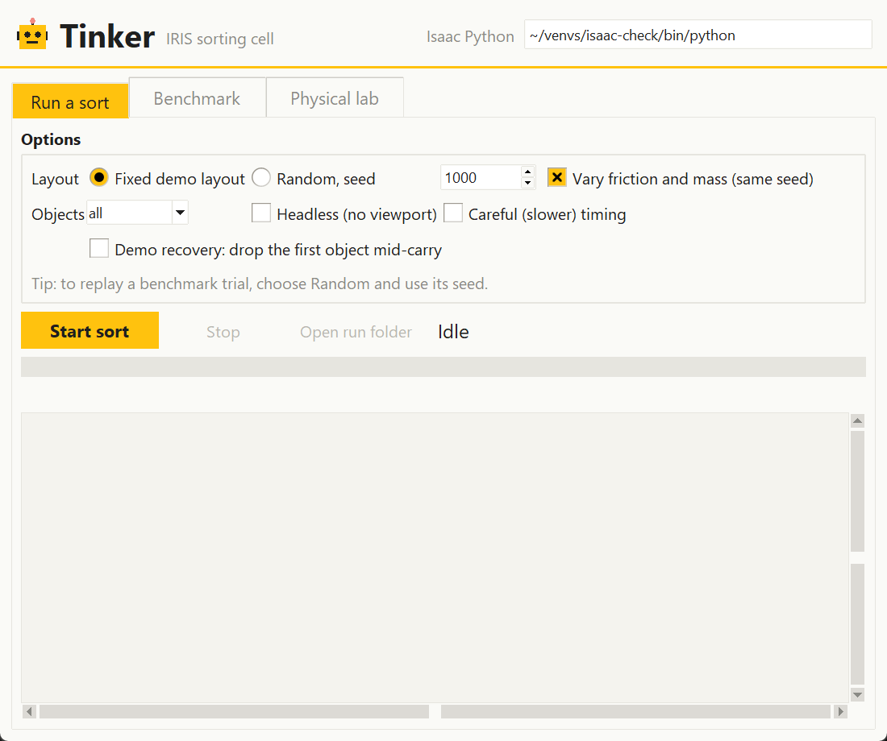
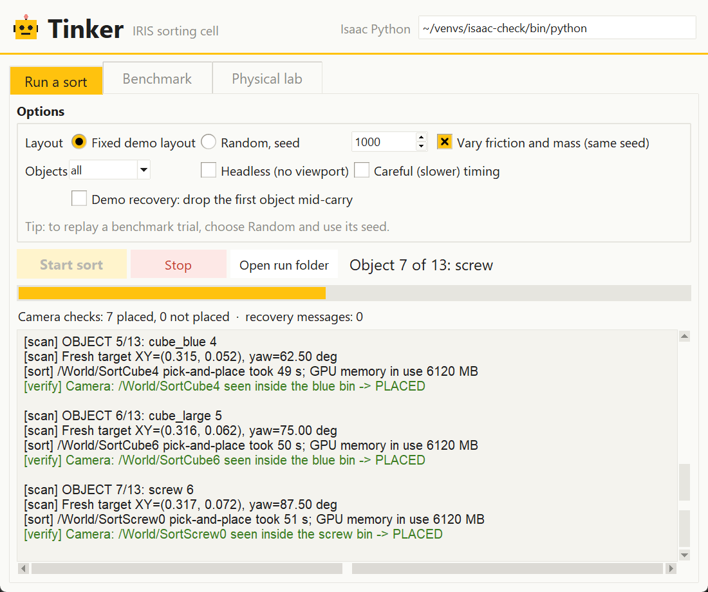
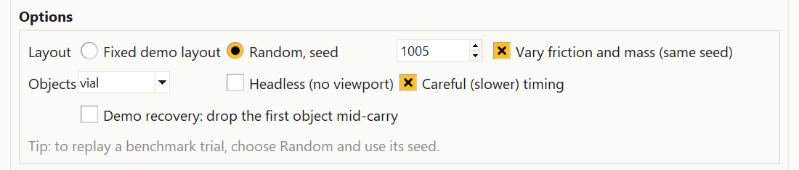
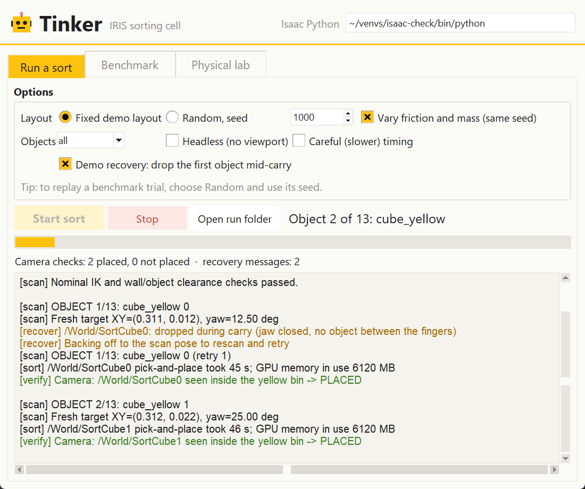
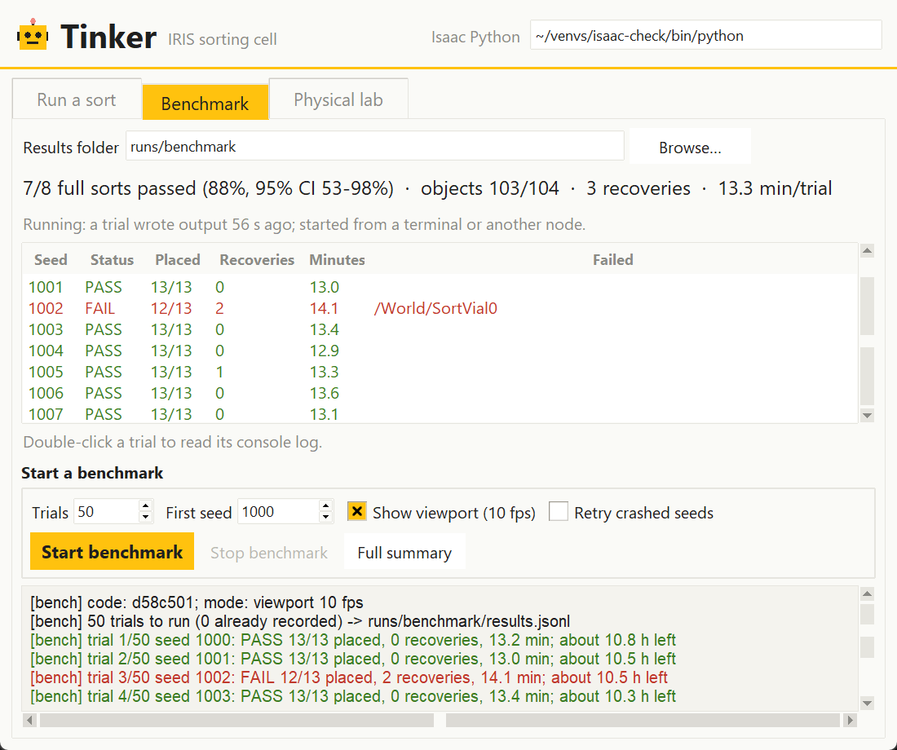
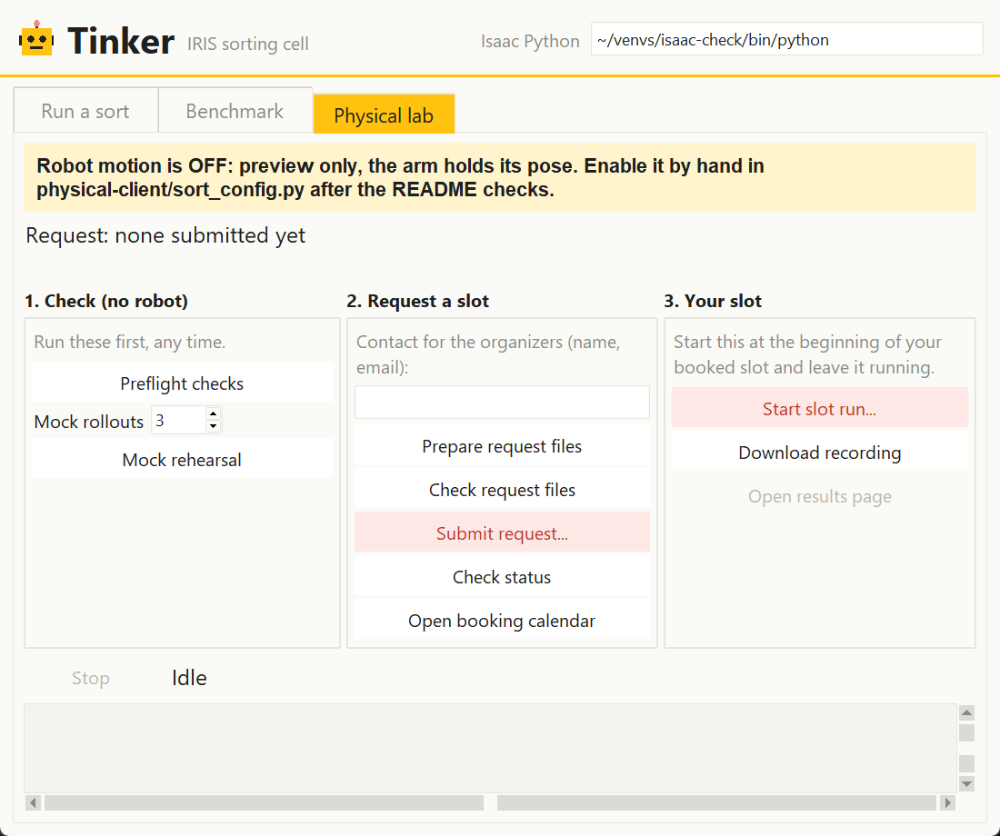
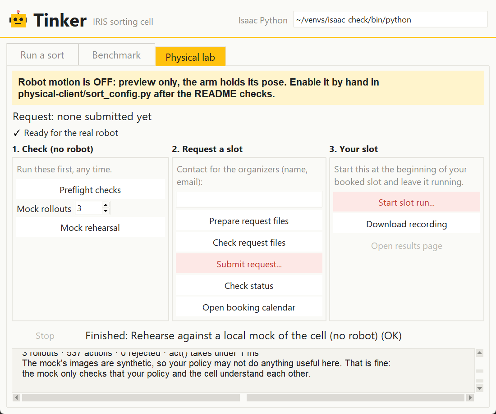

# Tinker User Manual

## Getting started

Tinker is a desktop app for the IRIS sorting cell. It runs the same commands you would type in the terminal and shows their progress live. Every button starts a script on the computer Tinker is running on.

| Tab | Where to run it | Why |
| --- | --- | --- |
| Run a sort | Rosie | Needs Isaac Sim and the GPU |
| Benchmark | Rosie | Needs Isaac Sim; results are saved on Rosie |
| Physical lab | Rosie or your laptop | Reaches the real cell over the internet |

**Start Tinker**

1. Open a terminal on Rosie, in the remote desktop where you watch the Isaac viewport. This is how the team runs it now. If you have other compute with Isaac Sim and a GPU, you can run Tinker there instead and follow the same steps.
2. Get the latest code:

   ```bash
   git pull
   ```

3. Go to the sim folder and start the app:

   ```bash
   cd fanuc_er4ia_sim
   python3 tinker.py
   ```

The app needs only the Python standard library. If no window opens, check that Tkinter is installed:

```bash
python3 -c "import tkinter; tkinter.Tk(); print('ok')"
```

To watch a benchmark saved in another folder, pass `--out`, for example `python3 tinker.py --out runs/benchmark_v2`.

## The window at a glance

The header sits at the top, and the three tabs below it each have their own Start and Stop buttons and a live log.



- **Isaac Python** (top right) is the Python that runs Isaac Sim. The default, `~/venvs/isaac-check/bin/python`, is correct on Rosie. Change it only if Isaac is installed somewhere else.
- **Yellow buttons** start something in the simulator.
- **Light-red buttons** stop a job or act on the real robot cell. The real-cell buttons always ask you to confirm first.
- **Log colours:** green means placed or passed, red means failed, and amber means a recovery or warning.
- **Closing the window** asks before stopping anything still running. A benchmark keeps running after Tinker closes.

## Tutorial 1: Your first sort

A full sort of all 13 objects on the fixed demo layout takes about 13 minutes, plus about a minute for Isaac Sim to start.

1. Open the **Run a sort** tab.
2. Leave the defaults: **Fixed demo layout**, Objects **all**, and nothing else ticked except **Vary friction and mass**.
3. Click **Start sort**. The status reads "Starting Isaac Sim (about a minute)…" and the Isaac viewport window opens.
4. Watch the progress:
   - The status line names the current object, for example "Object 7 of 13: screw".
   - The yellow bar fills as objects are done.
   - **Camera checks** counts objects the overhead camera saw in the right bin (placed) or not (not placed).
5. When the sort ends, the status shows **PASS** or **FAIL** with the count, for example "PASS: 13/13 objects placed; 0 recoveries".
6. Click **Open run folder** to see the saved files: `app_console.log` (the full log) and `sort_report.json` (per-object results).



To end a run early, click **Stop**. The status then reads "Stopped… no report written".

## Tutorial 2: Random layouts and replaying a trial

A seed number fixes a random layout, so the same seed always puts the objects in the same places. This lets you re-run any benchmark trial exactly.

**Run a random layout**

1. Under **Layout**, choose **Random, seed** and type a number, for example `1005`.
2. Keep **Vary friction and mass (same seed)** ticked to also randomize the physics, as the benchmark does. Untick it for the same layout with standard physics. This option has no effect on the fixed demo layout.
3. Click **Start sort**.

**Replay a benchmark trial**

1. On the **Benchmark** tab, note the seed of the trial you want to see, for example a FAIL row.
2. On **Run a sort**, choose **Random, seed**, enter that seed and keep **Vary friction and mass** ticked.
3. Click **Start sort** and watch the viewport to see what went wrong.



## Tutorial 3: Sort one object type, faster or slower

These options shorten a run when you are testing one thing. Combine them as needed with any layout.

| Option | What it does | Use it when |
| --- | --- | --- |
| **Objects:** screw, cube, vial or cap | Sorts only that type and leaves the rest on the table | Testing a tricky object, such as the 203 mm vials |
| **Headless (no viewport)** | Runs without the 3D window and exits when finished | You only need the result, or the remote desktop is slow |
| **Careful (slower) timing** | Slower, gentler arm motions | Checking whether a failure is caused by speed |

**Example: test only the vials on seed 1005**

1. Choose **Random, seed** and enter `1005`.
2. Set **Objects** to **vial**.
3. Tick **Careful (slower) timing** if you want to rule out speed.
4. Click **Start sort**. The progress counts only the vials, for example "Object 1 of 2: vial".

## Tutorial 4: Show a recovery

This option makes the robot drop the first object on purpose, so you can show it noticing and fixing the mistake. It is meant for demos.

1. Tick **Demo recovery: drop the first object mid-carry**. It works with any layout.
2. Click **Start sort**.
3. On the first object, amber `[recover]` lines appear in the log. The robot reports the drop, backs off to the scan pose, rescans and picks the object again, marked "(retry 1)".
4. The camera then confirms the object in its bin, and the sort continues as normal. **Recovery messages** counts the amber lines.



## Tutorial 5: Run and read a benchmark

A benchmark runs many random sorts back to back and reports how many pass. With the viewport on, each trial takes about 13 minutes, so 50 trials take about 11 hours.

**Start a benchmark**

1. Open the **Benchmark** tab. Check that **Results folder** is where you want the results, for example `runs/benchmark`.
2. Under **Start a benchmark**, set **Trials** (for example `50`) and **First seed** (for example `1000`). Trials use the seeds in order: 1000, 1001, 1002 and so on.
3. Leave **Show viewport (10 fps)** ticked to watch it, or untick it to run headless.
4. Tick **Retry crashed seeds** to re-run trials where Isaac Sim crashed. A crash is a simulator problem, not a robot failure.
5. Click **Start benchmark**. It keeps running after you close Tinker. Use **Stop benchmark** to end it.

Tinker refuses to start a benchmark if a trial in that folder wrote output in the last 3 minutes, so two runs never write to the same results.

**Read the results**



- **Stats line:** full sorts passed, the pass rate with its 95% confidence range, objects placed, recoveries and average minutes per trial.
- **Activity line:** "Running" if a trial wrote output recently, otherwise how long since the last output.
- **Table:** one row per trial. Green rows passed. Red rows failed or crashed, and **Failed** names the objects left unsorted.
- **Double-click a row** to open that trial's full console log.
- **Full summary** shows the detailed breakdown, including failures by object type.

To see a failed trial in the viewport, replay its seed (Tutorial 2).

## Tutorial 6: The physical lab

This tab walks through using the real robot cell, from a practice run to downloading your recording. Work left to right through the three boxes. Only one step runs at a time.



**Safety banner.** It shows whether robot motion is enabled in `physical-client/sort_config.py`. Tinker only reads this file and never changes it.

- **Yellow, motion OFF:** a slot run previews only, and the arm holds its pose. This is the current setting.
- **Light red, motion ON:** a slot run moves the real arm. Turn it on by hand only after the README checks.

**1. Check (no robot)**

1. Click **Preflight checks**. This checks calibration, the robot poses, and that SAM segmentation runs on the GPU, so run it on Rosie.
2. Set **Mock rollouts** (3 is enough) and click **Mock rehearsal**. Your program runs against a fake copy of the cell. A pass shows "✓ Ready for the real robot" with 0 rejected actions.



**2. Request a slot**

1. Type a contact name and email for the organizers.
2. Click **Prepare request files**, then **Check request files**, and fix anything it reports.
3. Click **Submit request…** and confirm. This sends your request to hackathon.sidclab.org. The **Request** line then shows your request ID.
4. Click **Check status** until the request is approved. Use **Open booking calendar** to book a time.

**3. Your slot**

1. At the start of your booked time, click **Start slot run…**. The confirmation says whether motion is ON or OFF.
2. Leave it running. The line under the banner shows progress: waiting for the operator, each rollout running and ending, then "All rollouts finished."
3. Afterwards, click **Download recording** to get your run's data.
4. **Open results page** becomes clickable once a results link appears in the log.

The secret in `physical-client/.request.json` is never shown. Logs for every step are saved in `runs/physical/`.

## Troubleshooting and saved files

| Problem | Fix |
| --- | --- |
| No window opens | Run the Tkinter check in Getting started. On Rosie, start Tinker from the remote desktop, not a plain SSH terminal. |
| "Isaac Python not found" | Fix the path in the **Isaac Python** box at the top right. |
| Sort says "Stopped (exit code …); no report written" | Isaac exited early. Open the run folder and read the end of `app_console.log`. |
| Benchmark refuses to start | A trial in that folder wrote output in the last 3 minutes. Wait for it to finish, stop it, or choose a new results folder. |
| Benchmark row shows CRASH | Isaac Sim crashed. Re-run with **Retry crashed seeds** ticked. |
| Preflight fails on the laptop | Preflight needs the GPU and SAM. Run it on Rosie. |

| What | Where it is saved |
| --- | --- |
| Single sorts | `runs/app_sort_<date>_<time>/` (`app_console.log`, `sort_report.json`) |
| Benchmark | `runs/benchmark/` (`results.jsonl`, `trial_<seed>/console.log`), with its log in `runs/benchmark.log` |
| Physical lab steps | `runs/physical/<step>_<time>.log` |

The screenshots in this manual were taken on a laptop. The sort and benchmark screenshots use sample output, because Isaac Sim does not run there. The mock rehearsal screenshot is from a real run.
