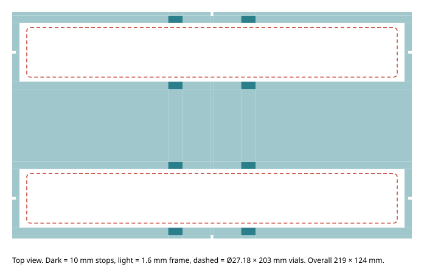

# Lab print kit

Everything to 3D-print for the physical lab test, in one folder. All STLs are
in millimetres and already lie flat on the bed. **Do not scale them.**

These are copies. The editable sources and generators are in
`../dual_zone_v2/` (gripper) and `../vial_holder/` (vial holder). If you change
a design there, regenerate it and copy the STLs here again.

## What to print

### Gripper fingers — `gripper/`

| File | Qty | Note |
|---|---:|---|
| `mounting_coupon.stl` | 1 | **Print first.** Test-fit it on the SMC jaw before printing the fingers |
| `left_body_tinker_logo.stl` | 1 | 93 × 74 × 15 mm; left body with the Tinker robot face engraved (see below) |
| `right_body.stl` | 1 | 93 × 74 × 15 mm |
| `contact_pad_primary_quantity_2.stl` | 2 *(optional)* | 6 × 32 × 1 mm; the file holds one pad. **TPU only** |
| `contact_pad_wide_quantity_2.stl` | 2 *(optional)* | 50 × 32 × 1 mm; the file holds one pad. **TPU only** |

**Pads: print them only in TPU, never PLA.** Rigid pads add the 1 mm thickness
but no grip, and the vial slides. The simpler route is to cut the four pads
(2 × 6 × 32 mm, 2 × 50 × 32 mm) from ~0.8 mm rubber sheet. Or wrap the bottom
32 mm of each rail with two layers of self-fusing silicone tape (~1 mm). Keep
the gripping face smooth, then check the closed gaps: about 18 mm (vial zone)
and 5.2 mm (screw zone).

Bring: 4 × M3 screws (about 16 mm; check against the real stack), 4 × M3 metal
nuts, washers, and adhesive for the pads.

### Vial holder — `vial_holder/`

| File | Qty | Note |
|---|---:|---|
| `vial_holder_full.stl` | 1 | 219 × 124 × 10 mm; needs a bed of at least 225 mm |
| `vial_holder_half_quantity_2.stl` | 2 | **Or** print these for a smaller bed. The halves are identical: rotate one 180° and butt them together at the centre notches |

Bring double-sided tape to fix it to the table.

## Why the gripper looks like this

The stock SMC MHZL2-16D2 jaws move only **6 mm each**, a 12 mm total stroke.
No single pair of fingers can cover both a 6 mm screw shank and a 27 mm vial
in that stroke. So each finger carries **two fixed contact zones**, 40 mm
apart along the finger:

| Zone | Gap closed → open (with pads) | Objects |
|---|---|---|
| Narrow | 5.2 → 17.2 mm | M6 screw shank, 10 mm and 16 mm cubes |
| Wide | 18.0 → 30.0 mm | Vial cap plug (~23 mm), Ø27.18 mm vial |

The robot picks the zone for each object by shifting its tool point.

- **Wide pad is 50 mm long, not 6 mm (V2.1).** The vial is 203 mm long and
  must be gripped near one end. If the grip were at the centre, the inactive
  narrow zone would push into the vial. In simulation a vial held off-centre
  in a 6 mm pad twisted about 45° and slipped out. A 50 mm pad running along
  the vial resists that twist.
- **1 mm compliant pads.** These give grip friction and a little squeeze.
  The gaps above include the pads, so the finished pad plus adhesive must be
  exactly 1 mm thick.
- **Mounting.** The fingers bolt through the stock jaw's two Ø3.4 mm holes
  (7 mm apart), onto the outside face of each jaw tongue. They are printed with
  Ø3.6 mm clearance holes and need metal nuts; there are no plastic threads.
  The coupon is a small test piece for that interface, so a wrong fit costs
  minutes instead of a full print.
- **Tinker logo.** The left body has the robot face from the Tinker app
  engraved 0.6 mm deep, 30 mm across. It sits on the outer face behind the
  wide rail, the side people see when the gripper is mounted. That face is
  printed on the bed, so the logo comes out crisp, and the antenna points
  toward the mount so the face reads upright when the fingers point down. It
  is cosmetic only: it touches no pad, bolt or contact face, and the rail
  stays 7.85 mm thick behind it. The plain `left_body.stl` is still in
  `../dual_zone_v2/cad/` if you prefer it. The generator is
  `../dual_zone_v2/engrave_tinker_logo.py`.
- **Checked in CAD:** the fingers and the stock actuator do not collide at 13
  jaw positions across the full stroke, and every STL is watertight.

## Why the vial holder looks like this

It is the physical copy of the simulator's vial destination
(`fanuc_er4ia_sim/scan_sort_bins.py`, `vial_stops()`), so the same plan works
in both.

- **Vials lie down.** A 203 mm vial does not fit the 35 mm bin pockets, and
  standing it up would be unstable. It is placed lying on its side.
- **Two slots, 80 mm apart:** one for each vial in the task. The spacing
  keeps the open fingers (48.9 mm across) clear of the neighbouring vial.
- **Four 10 mm stops per slot**, at ±20 mm from the slot centre with 2.5 mm
  side clearance. They stop the vial rolling. They sit near the middle because
  the gripper holds the vial 34.5–84.5 mm from its centre, so the stops stay
  clear of the 50 mm pad.
- **Open windows under each vial.** The vial rests on the table, not on
  plastic, exactly as in the simulator. The pick height and contact
  geometry therefore stay the same. The frame only ties the stops together at
  the right spacing.
- **Frame only 1.6 mm thick.** The fingertips go down to 5 mm above the table
  for a vial pick, which leaves 3.4 mm of clearance over the frame.
- **Half version.** The part is symmetric, so cutting it at the centre gives
  two identical halves that fit on a small bed.

## Before running the robot

1. Fit the coupon, then mount the fingers and check the full jaw travel.
2. Measure the real open and closed gaps and the tool point (TCP) of each zone.
   The old UTOOL1 does not match these fingers.
3. Tape down the vial holder where the program puts vials, then measure the
   slot centres with the robot. The physical policy (`sort_config.py`) drops
   vials at (0.17, −0.43) m from 100 mm up. The simulator places them
   gently in slots at (0.20, 0.35) and (0.20, 0.43) m. A vial dropped from
   100 mm may bounce off the stops, so lower the vial release height or update
   the destination first.

**Not validated:** physical fit, strength, pad adhesion, grip retention on
the real vial, or full-arm clearance. These parts are an untested prototype.
