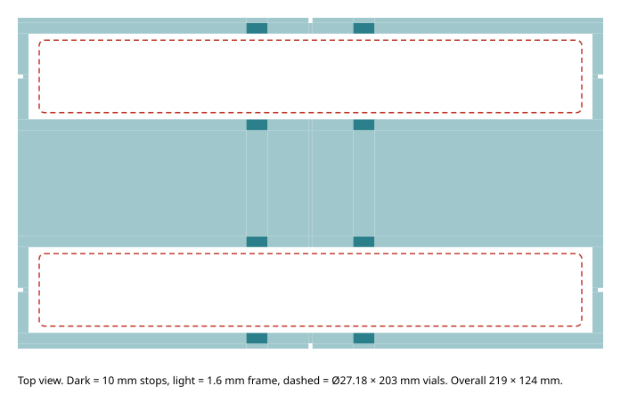

# Vial holder

A flat frame for the vial drop-off spot. It holds two real CSI vials
(Ø27.18 × 203 mm) lying on their sides. It is the physical version of the
simulator's vial destination for `FINGER_SET=dual_v2`
(`fanuc_er4ia_sim/scan_sort_bins.py`, `vial_stops()`):

- Two slots, 80 mm apart, with the vial axis along the frame's long side.
- Each slot has four stops, 8 × 4 × 10 mm tall, at ±20 mm from the slot centre.
  That leaves 2.5 mm of side clearance to the vial and keeps the stops clear of
  the 50 mm wide-zone pad, which grips 34.5–84.5 mm from the vial centre.
- The frame is only 1.6 mm thick and has an open window under each vial.
  **The vial rests on the table, as in the simulator.** The 5 mm fingertip pick
  height leaves 3.4 mm of clearance over the frame.



## What to print

| File | Qty | Size | Notes |
|---|---:|---|---|
| `cad/vial_holder_full.stl` | 1 | 219 × 124 × 10 mm | Needs a bed of at least 225 mm in one direction |
| `cad/vial_holder_half_quantity_2.stl` | 2 | 110 × 124 × 10 mm | For a smaller bed. The two halves are identical: rotate one 180° and butt them together at the centre-line notches |

Print one or the other. Both are flat on Z = 0, in millimetres; do not scale.
They need no supports. Any rigid filament works; 0.2 mm layers keep the frame
at 8 layers.

## Setting it up in the cell

1. Tape the frame to the table with double-sided tape.
   The notches mark the centre line (x = 0, on the long sides) and each slot's
   axis (on the short ends).
2. Place it where the program you run puts vials, with the long side along the
   vial axis the program uses:
   - Simulator spaced demo: slots at base (0.20, 0.35) and (0.20, 0.43) m,
     vial axis along base X.
   - Physical policy (`sort_config.py`): `DROP_XY["vials"] = (0.17, -0.43)`,
     released from `DROP_HEIGHT` = 100 mm. A vial dropped from 100 mm may
     bounce off the 10 mm stops. Lower the release height for vials, or treat
     the holder as a target zone only.
3. Measure the actual slot centres with the robot. Update the destination in
   the code before running a motion test.

## Regenerate / edit

```bash
python build_vial_holder.py
```

All dimensions are parameters at the top of the script. The script needs no
CAD library. It checks that every mesh is closed and watertight before
writing. `cad/vial_holder.scad` is the same model for OpenSCAD; set
`half = true` for the half part.

Not validated: physical fit with the real vial, finger clearance on the real
arm, and drop behaviour.
